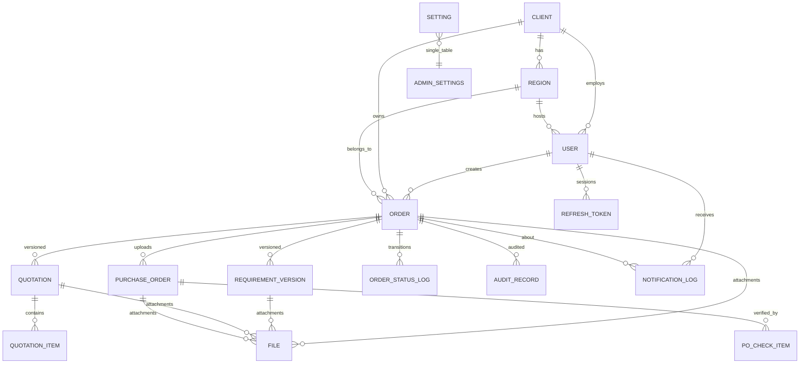

# Printoria B2B Order Workflow Portal — Phase 0 (Architecture & Design)

Confirmed stack: **React + TypeScript (Vite)** · **NestJS + Prisma** · **PostgreSQL** · **Redis + BullMQ** · **S3-compatible storage (MinIO in dev)** · **Docker** · Auth: **JWT access (15 min) + rotating refresh (7 d)** · WhatsApp: **provider interface + Mock provider now, Meta Cloud API later** · Configurables: **DB-backed admin settings with defaults**.

---

## 1. System architecture

```
                        ┌──────────────────────────────────────────────┐
  Browser (desktop/     │              React SPA (Vite/TS)             │
  mobile, responsive) ──►│  Role-aware UI, RTL-free, IST display        │
                        └─────────────────────┬────────────────────────┘
                                              │ HTTPS, REST + OpenAPI
                        ┌─────────────────────▼────────────────────────┐
                        │              NestJS API (apps/api)           │
                        │  ┌────────────┐ ┌───────────┐ ┌───────────┐  │
                        │  │ AuthModule │ │AdminModule│ │OrdersMod. │  │
                        │  │ guards,rate│ │clients/reg│ │state mach.│  │
                        │  └────────────┘ └───────────┘ └───────────┘  │
                        │  ┌────────────┐ ┌───────────┐ ┌───────────┐  │
                        │  │ FilesMod.  │ │Dashboard  │ │AuditMod.  │  │
                        │  │ S3+scan    │ │Module     │ │Module     │  │
                        │  └────────────┘ └───────────┘ └───────────┘  │
                        │  PricingRedactionInterceptor (server-side)   │
                        └───────┬──────────────┬──────────────┬────────┘
                                │              │              │
                    ┌───────────▼──┐   ┌───────▼─────┐  ┌─────▼──────────┐
                    │ PostgreSQL   │   │ Redis       │  │ S3 (MinIO dev) │
                    │ via Prisma   │   │ + BullMQ    │  │ + virus-scan   │
                    └──────────────┘   └───────┬─────┘  └────────────────┘
                                               │
                            ┌──────────────────▼──────────────────┐
                            │ Notification worker (BullMQ)        │
                            │ EmailProvider (SMTP dev/MailHog)    │
                            │ WhatsAppProvider interface          │
                            │   ├ MockWhatsAppProvider (dev)      │
                            │   ├ MetaCloudWhatsAppProvider (ph2) │
                            └─────────────────────────────────────┘
```

Key decisions

| Decision | Choice | Rationale |
|---|---|---|
| Monorepo | npm workspaces: `apps/api`, `apps/web`, `packages/shared` | Shared enums/DTO types, one Docker build each |
| ORM | Prisma | Typed queries, migrations, fast to build correctly |
| State machine | Single `OrderTransitionService` with a typed transition registry (see §5) | One enforcement point; unit-testable in isolation |
| Pricing security | `PricingRedactionInterceptor` strips pricing fields server-side unless user has `pricing.view`; DTOs annotated with `@PricingField()`. Applied to **API responses, CSV/Excel exports, audit & status-log payloads, notification payloads, quotation/PO file downloads, and search/filter parameters** (each with a dedicated test) | Cannot leak via forgotten UI hiding |
| Tenancy | Every scoped query goes through `OrderScopeService` returning a Prisma `where` clause from JWT claims | Regional → own region; HO → own client; Printoria → all |
| Notifications | BullMQ queue + worker; producer never throws into business flow; retry w/ exponential backoff; DLQ; `notification_log` table | Failure must not block workflow |
| IDs / numbering | `PRT-<seq>` from a single-row counter table updated inside the create transaction | Safe under concurrency |
| Deletion | Soft delete (`deleted_at`) everywhere; unique indexes are partial (`WHERE deleted_at IS NULL`) | No hard deletes |
| Time | Store UTC (`timestamptz`); render IST in web layer | |
| File upload | API issues S3 presigned PUT (or proxied multipart fallback), validates extension/MIME/size; virus-scan hook (`VirusScanner` interface, passthrough in dev, ClamAV container optional) | |

---

## 2. ER diagram



Entity catalogue:

- **Client** — corporate customer (Head Office org). `name, code, status, deleted_at`.
- **Region** — a client's regional office. `client_id, name, code, deleted_at`.
- **User** — `client_id (null ⇒ Printoria internal), region_id (client-regional only), role, permission_overrides json, pricing_view (Printoria only), email, password_hash, name, phone, status, last_login_at, deleted_at`.
  - Roles: `CLIENT_REGIONAL, CLIENT_HEAD_OFFICE, PRINTORIA_SALES, PRINTORIA_OPS, PRINTORIA_ADMIN`.
- **Order** — the lifecycle record. `order_number (PRT-1001…), client_id, region_id, created_by, title, status, status_entered_at, cancellation json{by,reason,at}, closed_at, deleted_at` + convenience denormalized current requirement fields (`item_name, quantity, unit, requested_delivery_date`) updated transactionally with each requirement version.
- **RequirementVersion** — `order_id, version, item_name, specification, quantity, unit, requested_delivery_date, notes, submitted_by, submitted_at, deleted_at`.
- **Quotation** (one row per version) — `order_id, version, quotation_ref (QTN-<order#>-vN), currency, sub_total, tax_amount, total_amount, payment_terms, delivery_terms, validity_date, status (DRAFT|SUBMITTED|APPROVED|REJECTED|REVISION_REQUESTED), submitted_by, submitted_at, decision json{action, actor, reason, at}, deleted_at`.
- **QuotationItem** — `quotation_id, description, specification, quantity, unit, unit_rate, tax_rate_pct, amount`.
- **PurchaseOrder** — `order_id, po_number, po_date, po_items jsonb[{desc, qty, rate, amount}], currency, po_total, tax_total, payment_terms, expected_delivery_date, external_ref, verified json{by, at, result}, status (PENDING_VERIFICATION|VERIFIED|QUERY_RAISED|SUPERSEDED), uploaded_by, uploaded_at, deleted_at`. Multiple uploads allowed; latest is active (others `SUPERSEDED`).
- **PoCheckItem** — `{po_id, check_key, check_label, expected, actual, matched (null|true|false), remark}` — the green/red checklist rows.
- **OrderStatusLog** — `order_id, from_status, to_status, action, actor_id, actor_role, reason (nullable), comment, metadata jsonb, created_at`. Written in the same transaction as the transition.
- **AuditRecord** — generic: `actor_id, entity_type, entity_id, action, before jsonb, after jsonb, ip, user_agent, created_at`. Covers non-status changes (draft edits, admin CRUD, settings changes, PO upload).
- **File** — `entity_type, entity_id, kind, original_name, s3_key, mime, size, checksum, scan_status, uploaded_by, deleted_at`.
- **NotificationLog** — `order_id, recipient_id, channel (EMAIL|WHATSAPP), template_key, to_address, to_phone, status (QUEUED|SENT|FAILED|RETRYING), attempts, last_error, payload jsonb (pricing-safe snapshot), queued_at, sent_at`.
- **RefreshToken** — `user_id, token_hash, expires_at, revoked_at, replaced_by_id, ip, user_agent`.
- **Setting** — `key, value jsonb, updated_by, updated_at` (single row per key; see §7).

## 3. Database schema (PostgreSQL DDL sketch — implemented as Prisma schema in Phase 1)

```sql
CREATE TYPE user_role AS ENUM ('CLIENT_REGIONAL','CLIENT_HEAD_OFFICE','PRINTORIA_SALES','PRINTORIA_OPS','PRINTORIA_ADMIN');
CREATE TYPE order_status AS ENUM (
  'SUBMITTED','RETURNED_FOR_CLARIFICATION','REJECTED','QUOTATION_IN_PROGRESS',
  'QUOTATION_SUBMITTED','REVISION_REQUESTED','AWAITING_PO','PO_RECEIVED',
  'ORDER_CONFIRMED','IN_PRODUCTION','QUALITY_CHECK','DISPATCHED','DELIVERED_CLOSED','CANCELLED');
CREATE TYPE quotation_status AS ENUM ('DRAFT','SUBMITTED','APPROVED','REJECTED','REVISION_REQUESTED');

CREATE TABLE clients (
  id uuid PRIMARY KEY DEFAULT gen_random_uuid(),
  name text NOT NULL, code text NOT NULL,
  status text NOT NULL DEFAULT 'ACTIVE',
  created_at timestamptz NOT NULL DEFAULT now(),
  updated_at timestamptz NOT NULL, deleted_at timestamptz);
CREATE UNIQUE INDEX clients_code_key ON clients (code) WHERE deleted_at IS NULL;

CREATE TABLE regions (
  id uuid PRIMARY KEY DEFAULT gen_random_uuid(),
  client_id uuid NOT NULL REFERENCES clients(id),
  name text NOT NULL, code text NOT NULL,
  created_at timestamptz NOT NULL DEFAULT now(), updated_at timestamptz NOT NULL,
  deleted_at timestamptz);
CREATE UNIQUE INDEX regions_client_code_key ON regions (client_id, code) WHERE deleted_at IS NULL;

CREATE TABLE users (
  id uuid PRIMARY KEY DEFAULT gen_random_uuid(),
  client_id uuid REFERENCES clients(id),        -- NULL ⇒ Printoria internal
  region_id uuid REFERENCES regions(id),        -- CLIENT_REGIONAL only
  role user_role NOT NULL,
  email text NOT NULL, password_hash text NOT NULL,
  full_name text NOT NULL, phone text,
  pricing_view boolean NOT NULL DEFAULT false,  -- Printoria users only
  status text NOT NULL DEFAULT 'ACTIVE',
  last_login_at timestamptz,
  created_at timestamptz NOT NULL DEFAULT now(), updated_at timestamptz NOT NULL,
  deleted_at timestamptz);
CREATE UNIQUE INDEX users_email_key ON users (lower(email)) WHERE deleted_at IS NULL;
CHECK (role NOT LIKE 'CLIENT%' OR client_id IS NOT NULL)  -- enforced via trigger or app-level invariant

CREATE TABLE orders (
  id uuid PRIMARY KEY DEFAULT gen_random_uuid(),
  order_number text NOT NULL,                   -- PRT-1001
  client_id uuid NOT NULL REFERENCES clients(id),
  region_id uuid NOT NULL REFERENCES regions(id),
  created_by uuid NOT NULL REFERENCES users(id),
  title text NOT NULL,
  status order_status NOT NULL DEFAULT 'SUBMITTED',
  status_entered_at timestamptz NOT NULL DEFAULT now(),
  item_name text, quantity numeric(14,3), unit text, requested_delivery_date date,
  cancellation jsonb, closed_at timestamptz,
  created_at timestamptz NOT NULL DEFAULT now(), updated_at timestamptz NOT NULL,
  deleted_at timestamptz);
CREATE UNIQUE INDEX orders_number_key ON orders (order_number) WHERE deleted_at IS NULL;
CREATE INDEX orders_client_region_idx ON orders (client_id, region_id, status) WHERE deleted_at IS NULL;

CREATE TABLE order_number_sequence (name text PRIMARY KEY, last_value bigint NOT NULL);

CREATE TABLE requirement_versions (
  id uuid PRIMARY KEY DEFAULT gen_random_uuid(),
  order_id uuid NOT NULL REFERENCES orders(id),
  version int NOT NULL,
  item_name text NOT NULL, specification text NOT NULL,
  quantity numeric(14,3) NOT NULL, unit text NOT NULL,
  requested_delivery_date date NOT NULL,
  notes text, submitted_by uuid NOT NULL REFERENCES users(id), submitted_at timestamptz NOT NULL,
  created_at timestamptz NOT NULL DEFAULT now(), deleted_at timestamptz,
  UNIQUE (order_id, version) WHERE deleted_at IS NULL);

CREATE TABLE quotations (
  id uuid PRIMARY KEY DEFAULT gen_random_uuid(),
  order_id uuid NOT NULL REFERENCES orders(id),
  version int NOT NULL,
  quotation_ref text NOT NULL,
  currency text NOT NULL DEFAULT 'INR',
  sub_total numeric(14,2), tax_amount numeric(14,2), total_amount numeric(14,2),
  payment_terms text, delivery_terms text, validity_date date,
  status quotation_status NOT NULL DEFAULT 'DRAFT',
  submitted_by uuid REFERENCES users(id), submitted_at timestamptz,
  decision jsonb,
  created_at timestamptz NOT NULL DEFAULT now(), updated_at timestamptz NOT NULL, deleted_at timestamptz,
  UNIQUE (order_id, version) WHERE deleted_at IS NULL);

CREATE TABLE quotation_items (
  id uuid PRIMARY KEY DEFAULT gen_random_uuid(),
  quotation_id uuid NOT NULL REFERENCES quotations(id) ON DELETE CASCADE,
  description text NOT NULL, specification text,
  quantity numeric(14,3) NOT NULL, unit text NOT NULL,
  unit_rate numeric(14,2) NOT NULL, tax_rate_pct numeric(5,2) NOT NULL DEFAULT 0,
  amount numeric(14,2) NOT NULL);

CREATE TABLE purchase_orders (
  id uuid PRIMARY KEY DEFAULT gen_random_uuid(),
  order_id uuid NOT NULL REFERENCES orders(id),
  po_number text NOT NULL, po_date date NOT NULL,
  po_items jsonb NOT NULL,                    -- [{description, quantity, unit, unit_rate, amount}]
  currency text NOT NULL DEFAULT 'INR',
  po_total numeric(14,2) NOT NULL, tax_total numeric(14,2),
  payment_terms text, expected_delivery_date date, external_ref text,
  status text NOT NULL DEFAULT 'PENDING_VERIFICATION',
  verification jsonb,
  uploaded_by uuid NOT NULL REFERENCES users(id), uploaded_at timestamptz NOT NULL,
  created_at timestamptz NOT NULL DEFAULT now(), updated_at timestamptz NOT NULL, deleted_at timestamptz);

CREATE TABLE po_check_items (
  id uuid PRIMARY KEY DEFAULT gen_random_uuid(),
  po_id uuid NOT NULL REFERENCES purchase_orders(id) ON DELETE CASCADE,
  check_key text NOT NULL, check_label text NOT NULL,
  expected text, actual text, matched boolean, remark text,
  UNIQUE (po_id, check_key));

CREATE TABLE order_status_log (
  id bigint GENERATED ALWAYS AS IDENTITY PRIMARY KEY,
  order_id uuid NOT NULL REFERENCES orders(id),
  from_status order_status, to_status order_status NOT NULL,
  action text NOT NULL, actor_id uuid NOT NULL REFERENCES users(id),
  actor_role user_role NOT NULL,
  reason text, comment text, metadata jsonb, created_at timestamptz NOT NULL DEFAULT now());

CREATE TABLE audit_records (
  id bigint GENERATED ALWAYS AS IDENTITY PRIMARY KEY,
  actor_id uuid REFERENCES users(id),
  entity_type text NOT NULL, entity_id uuid NOT NULL,
  action text NOT NULL, before jsonb, after jsonb,
  ip text, user_agent text, created_at timestamptz NOT NULL DEFAULT now());

CREATE TABLE files (
  id uuid PRIMARY KEY DEFAULT gen_random_uuid(),
  entity_type text NOT NULL, entity_id uuid,   -- attached post-upload (REQUIREMENT_VERSION, QUOTATION, PURCHASE_ORDER, ORDER)
  kind text NOT NULL,                          -- e.g. 'REQUIREMENT_ATT', 'PO_FILE', 'QUOTATION_ATT'
  original_name text NOT NULL, s3_key text NOT NULL UNIQUE,
  mime text NOT NULL, size_bytes bigint NOT NULL, checksum text,
  scan_status text NOT NULL DEFAULT 'PENDING', -- PENDING|CLEAN|INFECTED|SKIP
  uploaded_by uuid NOT NULL REFERENCES users(id),
  created_at timestamptz NOT NULL DEFAULT now(), deleted_at timestamptz);

CREATE TABLE notification_log (
  id bigint GENERATED ALWAYS AS IDENTITY PRIMARY KEY,
  order_id uuid REFERENCES orders(id),
  recipient_id uuid NOT NULL REFERENCES users(id),
  channel text NOT NULL CHECK (channel IN ('EMAIL','WHATSAPP')),
  template_key text NOT NULL, to_address text, to_phone text,
  status text NOT NULL DEFAULT 'QUEUED',
  attempts int NOT NULL DEFAULT 0, last_error text,
  payload jsonb, queued_at timestamptz NOT NULL DEFAULT now(), sent_at timestamptz);

CREATE TABLE refresh_tokens (
  id uuid PRIMARY KEY DEFAULT gen_random_uuid(),
  user_id uuid NOT NULL REFERENCES users(id),
  token_hash text NOT NULL UNIQUE, expires_at timestamptz NOT NULL,
  revoked_at timestamptz, replaced_by uuid, ip text, user_agent text,
  created_at timestamptz NOT NULL DEFAULT now());

CREATE TABLE settings (
  key text PRIMARY KEY, value jsonb NOT NULL,
  updated_by uuid REFERENCES users(id), updated_at timestamptz NOT NULL DEFAULT now());
```

## 4. Role / permission matrix

Permissions (checked server-side, derived from role + per-user overrides):

`order.create · order.view · requirement.update · requirement.decide · quotation.manage · quotation.decide · po.upload · po.verify · order.confirm · fulfilment.advance · order.cancel · pricing.view · admin.clients · admin.regions · admin.users · admin.settings · audit.view · notification.manage`

| Permission | CLIENT_REGIONAL | CLIENT_HEAD_OFFICE | PRINTORIA_SALES | PRINTORIA_OPS | PRINTORIA_ADMIN |
|---|---|---|---|---|---|
| order.create | ✔ (own region) | — | — | — | — |
| order.view | ✔ own region | ✔ own client | ✔ all | ✔ all | ✔ all |
| requirement.update | ✔ own region (when allowed) | — | — | — | — |
| requirement.decide (approve/return/reject) | — | ✔ | — | — | — |
| quotation.manage (draft/revise/submit) | — | — | ✔ | — | — |
| quotation.decide (approve/revise/reject) | — | ✔ | — | — | — |
| po.upload (client HO only) | — | ✔ | — | — | — |
| po.verify (checklist, query, confirm) | — | — | — | ✔ | — |
| fulfilment.advance | — | — | — | ✔ | — |
| order.cancel | — | ✔ (until Order Confirmed) | — | ✔ (until Dispatched) | ✔ |
| pricing.view | ✖ never | ✔ | ✔ | per-user flag | ✔ |
| admin.* | — | — | — | — | ✔ |
| audit.view | own orders | own client | ✔ | ✔ | ✔ |

Data scope: client users are always filtered by their `client_id`; `CLIENT_REGIONAL` additionally by `region_id`. Printoria users see all clients. **Regional users can never receive `pricing.view`, even via override (hard-coded deny).**

## 5. Order state machine

Statuses (enum): `SUBMITTED → RETURNED_FOR_CLARIFICATION / REJECTED → QUOTATION_IN_PROGRESS → QUOTATION_SUBMITTED → REVISION_REQUESTED / AWAITING_PO → PO_RECEIVED → ORDER_CONFIRMED → IN_PRODUCTION → QUALITY_CHECK → DISPATCHED → DELIVERED_CLOSED` (+ `CANCELLED` from allowed stages).

Transition table — `(current, actor role, action) → next`:

| # | Current status | Role (permission) | Action | Next status | Reason required |
|---|---|---|---|---|---|
| 1 | SUBMITTED | CLIENT_REGIONAL `requirement.update` | update requirement (new version) | SUBMITTED | — |
| 2 | SUBMITTED | CLIENT_HO `requirement.decide` | approve | QUOTATION_IN_PROGRESS | — |
| 3 | SUBMITTED | CLIENT_HO `requirement.decide` | return_for_clarification | RETURNED_FOR_CLARIFICATION | ✔ |
| 4 | SUBMITTED | CLIENT_HO `requirement.decide` | reject | REJECTED | ✔ |
| 5 | RETURNED_FOR_CLARIFICATION | CLIENT_REGIONAL `requirement.update` | resubmit (new version) | SUBMITTED | — |
| 6 | QUOTATION_IN_PROGRESS | PT_SALES `quotation.manage` | save_draft | — (stays) | — |
| 7 | QUOTATION_IN_PROGRESS | PT_SALES `quotation.manage` | submit_quotation (new version) | QUOTATION_SUBMITTED | — |
| 8 | QUOTATION_SUBMITTED | CLIENT_HO `quotation.decide` | approve_quotation | AWAITING_PO | — |
| 9 | QUOTATION_SUBMITTED | CLIENT_HO `quotation.decide` | request_revision | REVISION_REQUESTED | ✔ |
| 10 | QUOTATION_SUBMITTED | CLIENT_HO `quotation.decide` | reject_quotation | REJECTED | ✔ |
| 11 | REVISION_REQUESTED | PT_SALES `quotation.manage` | save_draft / revise (new version) | — / QUOTATION_SUBMITTED | — |
| 12 | AWAITING_PO | CLIENT_HO `po.upload` | upload_po (multipart) | PO_RECEIVED | — |
| 13 | PO_RECEIVED | PT_OPS `po.verify` | raise_po_query | AWAITING_PO | ✔ (goes back to HO) |
| 14 | AWAITING_PO | CLIENT_HO `po.upload` | re-upload/replace PO | PO_RECEIVED | — |
| 15 | PO_RECEIVED | PT_OPS `order.confirm` | confirm_order (checklist all-green, or mismatches + mandatory override remark) | ORDER_CONFIRMED | override remark if mismatches |
| 16 | ORDER_CONFIRMED | PT_OPS `fulfilment.advance` | start_production | IN_PRODUCTION | — |
| 17 | IN_PRODUCTION | PT_OPS `fulfilment.advance` | start_qc | QUALITY_CHECK | — |
| 18 | QUALITY_CHECK | PT_OPS `fulfilment.advance` | dispatch (transporter, AWB) | DISPATCHED | — |
| 19 | DISPATCHED | PT_OPS `fulfilment.advance` | mark_delivered | DELIVERED_CLOSED | — |
| 20 | QUOTATION_IN_PROGRESS | PT_SALES `quotation.manage` | revise→submit | QUOTATION_SUBMITTED | — |

Cancellation (each writes `order.cancellation{by, reason, at}` + status log; rules are **setting-driven**, defaults shown):

| Current status | Who by default |
|---|---|
| SUBMITTED / RETURNED_FOR_CLARIFICATION | CLIENT_REGIONAL, CLIENT_HO |
| QUOTATION_IN_PROGRESS / QUOTATION_SUBMITTED / REVISION_REQUESTED / AWAITING_PO | CLIENT_HO (Regional only if setting allows) |
| PO_RECEIVED | CLIENT_HO, PT_OPS — cancellation charges flag applies (setting) |
| ORDER_CONFIRMED → QUALITY_CHECK | PT_OPS / PT_ADMIN only, charges flag (setting) |
| DISPATCHED and later | ✖ not cancellable (setting could extend, default no) |

Rules enforced mechanically: unknown `(status, role, action)` triples → HTTP 409 with current status and allowed actions; reason absent where required → 422; every acceptance writes `order_status_log` + `audit_records` in the same transaction.

## 6. API endpoints (v1, prefix `/api/v1`; OpenAPI via NestJS Swagger)

**Auth**
- `POST /auth/login` (email+password → access + refresh; rate-limited 5/15min per email+IP)
- `POST /auth/refresh`, `POST /auth/logout`, `GET /auth/me` (profile + effective permissions)

**Admin (PRINTORIA_ADMIN)**
- `GET/POST /admin/clients`, `GET/PATCH/DELETE /admin/clients/:id`
- `GET/POST /admin/clients/:id/regions`, `GET/PATCH/DELETE /admin/regions/:id`
- `GET/POST /admin/users`, `GET/PATCH/DELETE /admin/users/:id` (roles, region, pricing_view, reset password)
- `GET/PUT /admin/settings`, `GET /settings/public` (non-sensitive UI knobs)

**Orders / workflow**
- `POST /orders` (CLIENT_REGIONAL create requirement; multipart attachments)
- `GET /orders` — scoped list; filters: client, region, status, date range,orderId, search, paging; `GET /orders/:id` (pricing-redacted per role)
- `POST /orders/:id/requirement-versions` (regional update/resubmit)
- `POST /orders/:id/requirement-decision` `{action: approve|return|reject, reason?}`
- `POST /orders/:id/quotations` (sales draft, version auto), `PUT /quotations/:id` (draft edit), `POST /quotations/:id/submit`
- `POST /orders/:id/quotation-decision` `{action: approve|request_revision|reject, reason?}`
- `POST /orders/:id/purchase-orders` (HO multipart PO upload w/ details)
- `GET /orders/:id/purchase-orders/:poId/checklist` (green/red rows)
- `POST /orders/:id/purchase-orders/:poId/decision` `{action: confirm|raise_query, reason?, override_remark?}`
- `POST /orders/:id/transitions` `{action, reason?, payload?}` (fulfilment steps, cancel)
- `GET /orders/:id/audit` (status log + audit merge)
- `GET /audit` (admin, global)

**Files**
- `POST /files/presign` (returns S3 presigned PUT + file id), `GET /files/:id/download-url`

**Dashboard / reports / notifications**
- `GET /dashboard/summary` (cards, role-specific)
- `GET /dashboard/pending-actions`, `GET /dashboard/status-chart`
- `GET /reports/orders?format=csv` (same filters as list; export)
- `GET /notifications` (own; admins all), `POST /notifications/reminders/run` (admin/cron)

Error model: RFC-7807-ish JSON `{code, message, details}`; 401 bad/expired token · 403 role/permission/tenancy · 409 invalid state transition (response includes `allowedActions`) · 422 validation/reason missing · 413 file too large.

## 7. Admin settings (seeded defaults, editable in Phase 1+ admin UI)

| Key | Default |
|---|---|
| `delay_threshold_hours` | `{"default":48, "per_stage":{"ORDER_CONFIRMED":72,"PO_RECEIVED":24}}` |
| `cancellation_rules` | `{"client_ho_until":"ORDER_CONFIRMED-excl", "printoria_ops_until":"QUALITY_CHECK", "charges_after_po":true, "regional_may_cancel":false}` |
| `post_confirmation_changes` | `{"allow_qty":false,"allow_spec":false,"requires_roles":["PT_ADMIN"],"require_reason":true}` |
| `fulfilment_visibility` | `{"show_to_client":true,"visible_statuses":["IN_PRODUCTION","QUALITY_CHECK","DISPATCHED"]}` |
| `notifications` | `{"email":true,"whatsapp":true,"reminder_interval_hours":24,"quiet_hours_ist":null}` |
| `uploads` | `{"max_mb":25,"allowed":["pdf","jpg","jpeg","png","xlsx","docx","ai","cdr"],"blocklist":[]}` |
| `order_numbering` | `{"prefix":"PRT","start":1001}` |

Cancelled / Rejected are terminal. Quotation `DRAFT` rows are invisible to clients until submitted.

## 8. Notifications (Phase 1 email, Phase 2 WhatsApp)

- Producer: workflow services push `{template_key, order_id, recipients[], pricing_safe_payload}` to BullMQ `notifications` queue **after** the DB transaction commits (transactional outbox-like pattern: rows in `notification_log` created in-tx, worker picks up).
- Templates (keys): `requirement_submitted, requirement_returned, requirement_approved, requirement_rejected, quotation_submitted, quotation_revision_requested, po_received, po_query_raised, po_mismatch_flagged, order_confirmed, order_dispatched, order_delivered, order_cancelled, approval_reminder`.
- Regional recipients always get pricing-stripped snapshots (enforced in template payload builder, not by trust).
- EmailProvider: SMTP w/ MailHog in dev. WhatsAppProvider interface: `send(templateKey, toPhone, params) → providerRef`; Mock provider logs to `notification_log` + console; Meta Cloud implementation lands Phase 2 (needs WABA + template approval — lead time risk noted).
- Remedies: 5 retries exponential (1m, 5m, 30m, 2h, 6h), then FAILED + DLQ; admin re-run endpoint.

## 9. PO verification checklist (computed on upload + on view)

| Check | Expected (from approved quotation v) | Actual (from PO) | Red ⇢ |
|---|---|---|---|
| quotation_ref | `QTN-…-vN` latest approved | po reference field / notes | missing/other version |
| item_spec | quotation item description+spec | po item | any difference (exact match) |
| quantity | quotation qty | po qty | any difference (exact match) |
| unit_rate | quotation rate | po rate | any difference (exact match) |
| total_amount | quotation total | po total | difference beyond 0.5% tolerance |
| tax_payment | tax amount + payment terms | po tax + terms | tax diff beyond 0.5%; payment terms text mismatch (exact) |
| delivery_date | quotation delivery terms date | po expected date | earlier than quotation ⇒ red |
| po_vs_validity | within quotation validity_date | po_date | past validity ⇒ red |

Operations confirms with any reds **only** if `override_remark` present (stored on `purchase_orders.verification`, audit-logged).

**Approved tolerance rule (change #1)**: the 0.5% numerical tolerance applies **only** to `total_amount` and `tax_payment`. Quantity, unit rate, item/spec, quotation version and delivery date are **exact matches**.

## 10. Tests planned (Vitest + Supertest; state machine table-driven)

1. **State machine** — every legal row of §5 passes; every illegal pair → 409; reason-missing → 422; audit row created per transition.
2. **Permissions** — regional cannot call `requirement-decision` etc.; ops cannot quote; sales cannot verify PO.
3. **Pricing visibility** — as a regional user, deep-scan every surface for rate/total/tax/payment-terms leakage: (a) API JSON responses, (b) CSV/Excel export rows, (c) audit & status-log payloads, (d) rendered notification payloads, (e) quotation/PO file download responses and metadata, (f) search/filter parameters (e.g. filter-by-amount is rejected server-side). Each surface is its own test. Regional users additionally never see `payment_terms`/commercial details in the business profile.
4. **Tenancy isolation** — seeded client A user requests client B order ⇒ 403/404; list never returns foreign rows; regional (own region) and HO (all regions) scoping tested.
5. **PO mismatch logic** — golden cases per §9 row incl. tolerance and override remark enforcement.
6. **Order numbering** — concurrent creates produce unique `PRT-100x`.
7. **Auth** — refresh rotation/revocation, rate limiting, bcrypt storage.

## 11. Environments (env vars)

```
NODE_ENV, PORT=3000
DATABASE_URL=postgresql://...
REDIS_URL=redis://...
JWT_ACCESS_SECRET, JWT_REFRESH_SECRET, JWT_ACCESS_TTL=15m, JWT_REFRESH_TTL=7d
S3_ENDPOINT, S3_BUCKET, S3_ACCESS_KEY, S3_SECRET_KEY (MinIO dev)
SMTP_URL (MailHog dev), EMAIL_FROM
WHATSAPP_PROVIDER=mock|meta, META_WA_TOKEN, META_WA_PHONE_ID (Phase 2)
VIRUS_SCAN=off|clamav, CLAMAV_URL
DEFAULT_TZ_DISPLAY=Asia/Kolkata
```

## 12. Risks / notes

- **Prisma + partial unique indexes** need raw `CREATE UNIQUE INDEX` migrations — fine, scripted.
- **Meta WhatsApp template approval** takes days — start provider account paperwork before Phase 2; mock keeps us unblocked.
- **Approved**: 0.5% tolerance only for PO total & tax (change #1); all other PO checks exact.

## 13. Business Profile module (added from prototype/spec, built in Phase 1)

Client-facing "Business Profile" page (the one described in the spec): company details, statutory/commercial details, addresses, regional offices table, key contacts table, order alert preferences.

Schema additions:

```sql
ALTER TABLE clients
  ADD COLUMN registered_name text, industry text, client_since date,
  website text, business_email text, phone text,
  gstin text, pan_no text, cin text, payment_terms text,
  registered_address text, city text, state text, pincode text, billing_address text,
  code text;

ALTER TABLE regions
  ADD COLUMN city text, manager_name text, manager_email text;

CREATE TABLE client_contacts (
  id uuid PRIMARY KEY DEFAULT gen_random_uuid(),
  client_id uuid NOT NULL REFERENCES clients(id),
  name text NOT NULL, role_name text, email text NOT NULL, phone text,
  created_at timestamptz NOT NULL DEFAULT now(), updated_at timestamptz NOT NULL, deleted_at timestamptz);

CREATE TABLE client_notification_prefs (
  client_id uuid PRIMARY KEY REFERENCES clients(id),
  email_alerts boolean NOT NULL DEFAULT true,
  whatsapp_alerts boolean NOT NULL DEFAULT true,
  daily_pending_reminder boolean NOT NULL DEFAULT true,
  updated_by uuid REFERENCES users(id), updated_at timestamptz NOT NULL DEFAULT now());
```

Rules:
- **CLIENT_HEAD_OFFICE** (own client) and **PRINTORIA_ADMIN** (any client): view + edit everything; PT Admin additionally gets the Account status activate/deactivate control (`clients.status`).
- **CLIENT_REGIONAL**: read-only; sees only their own region's office row; `payment_terms`, GSTIN/PAN/CIN and contact phone numbers of commercial use are **redacted server-side** (same interceptor as pricing).
- Alert prefs are **client-level**, editable by HO/PT Admin, and honoured by the notification fan-out (regional users' mails still carry no pricing regardless of toggles).
- Validation (server + client): GSTIN 15-char pattern, PAN `^[A-Z]{5}[0-9]{4}[A-Z]$` ("10 characters, like AABCA1234F"), CIN 21 chars, PIN `^[1-9][0-9]{5}$`, email, 10-digit phone (allow +91/0), website must be http(s) URL; errors under the header in plain language, page scrolls to them; "Add regional office"/"Add contact"/inline Remove per the spec; empty-table helper lines; checkboxes disabled in view mode.

Endpoints:
- `GET /api/v1/clients/me/profile` (any client user; regional gets redacted + own-region-only offices)
- `PATCH /api/v1/clients/me/profile` (HO; multipart not needed)
- `GET/PATCH /api/v1/admin/clients/:id/profile` (PT Admin, + `{status}` toggle)
- Contact endpoints: `POST/DELETE /api/v1/clients/me/contacts/:id` and `.../regions/:rid` HO/PT Admin-managed inline actions.

## 14. Approved change log (Phase 0 review)

1. PO-verification tolerance limited to `total_amount` & `tax_payment`; all other checks exact. ✔
2. Requirement edits = new versions. ✔
3. Global `PRT-xxxx` numbering. ✔
4. Pricing redaction extended to exports, audit/status payloads, notification templates, file downloads, search/filter params — each with a test. ✔
5. Cancellation rules / delay thresholds / fulfilment sub-statuses stay admin settings with defaults; Printoria's final values to be confirmed later. ✔
6. Business Profile module added (§13) to match prototype visuals: light-grey page on white cards (8–10px radius), dark mode via system setting, deep-magenta accent used sparingly (header underline, primary buttons, logo tile, focus outlines), system sans-serif 14px body / 22px company name / 16px section titles, max-width 980px, mobile-stacking + sideways-scrolling tables, visible magenta focus outlines.
- **Requirement edits by Regional after submit**: modelled as new versions (1/5 above) rather than in-place edits — keeps full history, audit-friendly.
- **GST/invoicing** intentionally out of scope; ` PurchaseOrder.external_ref` + clean service layer keep ERP hooks feasible later.
